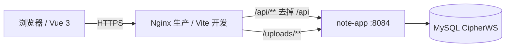

# CipherWS 笔记系统（池禾笔记）

在线笔记 + AI 智能总结 + 后台管控。

后端是一个 **Spring Boot 单体应用**：一个进程、一个端口、一个数据库、一个 jar，不再需要 Nacos、Spring Cloud、注册中心或 Java 网关。

> Java 17 · Spring Boot 3.5 · MyBatis · MySQL 8 · Vue 3 · Vite

---

## 目录

- [一、项目简介](#一项目简介)
- [二、功能特性](#二功能特性)
- [三、系统架构](#三系统架构)
- [四、技术栈](#四技术栈)
- [五、项目结构](#五项目结构)
- [六、快速开始](#六快速开始)
- [七、配置说明](#七配置说明)
- [八、数据库](#八数据库)
- [九、接口概览](#九接口概览)
- [十、构建与部署](#十构建与部署)
- [十一、部署脚本](#十一部署脚本)
- [十二、常见问题](#十二常见问题)
- [十三、已知限制](#十三已知限制)
- [十四、安全注意事项](#十四安全注意事项)
- [十五、相关文档](#十五相关文档)

---

## 一、项目简介

CipherWS 笔记系统从 CipherWS 主仓库中拆出，只保留 note 子系统，提供：

- 用户注册、登录、找回密码、个人资料、头像；
- 笔记的新建、编辑、搜索、回收站；
- 标签、文件夹和自动整理；
- AI 对笔记正文生成摘要，按额度计费；
- 管理员用户管理、笔记巡检、公告、AI 参数、日志与统计。

项目最初是 4 个微服务（user / core / ai / admin）+ 公共模块，后来合并成一个单体应用，目的是降低部署、联调和维护成本。

### 角色

| 角色 | 权限 |
| --- | --- |
| 普通用户 | 管理自己的资料、笔记、标签、文件夹，使用 AI 总结，查看公告 |
| 管理员 | 普通用户全部能力 + 用户管理、笔记巡检、公告管理、AI 配置、日志统计 |

### 业务约束

- 笔记全部私有，暂不支持分享、协作、公开链接；
- AI 总结每次消耗 1 次额度，额度由管理员分配；
- 管理员只能标记违规笔记，不能修改用户笔记正文；
- 标签、文件夹属于用户私有数据；
- 文件夹只有一层；
- 当前没有草稿/发布状态，笔记统一为 `private`。

---

## 二、功能特性

### 登录与用户中心

- 邮箱验证码注册、邮箱 + 密码登录、BCrypt 密码校验；
- 验证码 5 分钟有效、60 秒冷却、最多试错 5 次；
- 找回密码、修改密码（旧密码 + 邮箱验证码）；
- 个人资料、头像上传、换绑邮箱（先验证旧邮箱，再验证新邮箱）；
- AI 额度查询。

### 笔记

- 新建、编辑、删除、详情、搜索；
- 回收站：软删除、恢复、永久删除、清空；
- 按标题/正文搜索，按文件夹、标签、未分类筛选；
- 分页，单页最多 100 条；
- 所有查询按 `user_id` 隔离，越权与不存在统一处理。

### 标签与文件夹

- 标签创建、重命名、删除；
- 笔记绑定多个标签，按标签筛选；
- 单层文件夹，移动笔记、删除文件夹后笔记退回未分类；
- 按“文件夹名 = 标签名”自动整理未分类笔记。

### AI 智能总结

- 管理员配置接口地址、密钥、模型、单次最大字数；
- 调用 OpenAI 兼容的 `/chat/completions`；
- 摘要写入 `note_ai_summary_record`，按笔记查看历史；
- 成功后原子扣减 `ai_quota`；
- 连接超时 10 秒、读超时默认 60 秒。

### 后台管理

- 用户列表、启用/禁用、重置 AI 额度（0–9999）；
- 笔记巡检，只能修改 `flagged`；
- 公告发布、编辑、下线、删除；
- AI 参数读取/保存，密钥只回掩码；
- 用户/管理员操作日志查询；
- 近 7 天 AI 调用趋势、调用排行、总量统计。

---

## 三、系统架构



### 请求链路

```text
浏览器
  → Nginx / Vite
      /api/**     → 8084（去掉 /api 前缀）
      /uploads/** → 8084（原样转发）
  → note-app:8084
      ├─ user 包
      ├─ core 包
      ├─ ai 包
      └─ admin 包
  → MySQL CipherWS
```

### 端口

| 组件 | 端口 |
| --- | --- |
| 单体后端 `note-app` | 8084 |
| 前端开发服务器 | 8002 |
| MySQL | 3306 |

### 请求路径

| 前端请求 | 后端实际路径 |
| --- | --- |
| `/api/auth/**` | `/auth/**` |
| `/api/user/**` | `/user/**` |
| `/api/notes/**` | `/notes/**` |
| `/api/tags/**` | `/tags/**` |
| `/api/folders/**` | `/folders/**` |
| `/api/ai/**` | `/ai/**` |
| `/api/admin/**` | `/admin/**` |
| `/api/announcements` | `/announcements` |
| `/uploads/**` | `/uploads/**`（不剥前缀） |

Nginx 和 Vite 都只配置一个后端目标 `127.0.0.1:8084`。

### 认证

- 登录成功后签发 HS256 JWT，载荷含 `uid`、`sub`（邮箱）、`role`、`iat`、`exp`，默认 30 天；
- `common` 包中的 `JwtAuthFilter` 是 Servlet 过滤器：
  - 白名单：`/auth/register`、`/auth/login`、`/auth/send-code`、`/auth/reset-password`、`/actuator/**`、`/uploads/**`；
  - 其余请求校验 `Authorization: Bearer <token>`；
  - 先删除客户端伪造的 `X-User-Id`、`X-User-Role`、`X-Username`，验签通过后再写回可信值。
- 控制器使用 `@RequestHeader` 读取身份；`Auth.requireAdmin(role)` 拦截非管理员；
- `NOTE_JWT_SECRET` 至少 32 字节，未配置或过短时启动失败。

### 数据访问

- MyBatis XML Mapper，SQL 全部在 `server/src/main/resources/mapper/*.xml`；
- 实体在 `common/entity`，模板使用 `map-underscore-to-camel-case`；
- 所有用户数据 SQL 都带 `user_id`；
- 写操作在 Service 层使用 `@Transactional`。

---

## 四、技术栈

| 层级 | 技术 | 版本/说明 |
| --- | --- | --- |
| 语言 | Java | 17 |
| 后端框架 | Spring Boot | 3.5.16 |
| 持久层 | MyBatis | 3.0.4，XML Mapper |
| 数据库 | MySQL | 8.x，`utf8mb4`，HikariCP |
| 鉴权 | HS256 JWT | `JwtUtil` + `JwtAuthFilter` |
| 密码 | BCrypt | `spring-security-crypto` |
| 邮件 | Spring Mail | 可选 SMTP |
| 构建 | Maven Wrapper | `server/mvnw.cmd` |
| 前端框架 | Vue | 3.5.x，Composition API |
| 前端构建 | Vite | 6.3.x |
| 路由/状态 | Vue Router 4 / Pinia 2 | history 模式 |
| 请求 | 原生 `fetch` | `src/api/request.js` |
| 样式 | 原生 CSS | 无 UI 组件库 |
| 部署 | Nginx | 静态站 + 反代 8084 |

后端不再包含 Nacos、Spring Cloud、Gateway、WebFlux、LoadBalancer。

---

## 五、项目结构

```text
note/
├── frontend/note/                 # Vue 3 前端
│   ├── src/
│   │   ├── api/                   # request.js + index.js
│   │   ├── components/
│   │   ├── layouts/
│   │   ├── router/
│   │   ├── stores/
│   │   ├── styles/
│   │   └── views/                 # auth / notes / admin / 用户中心
│   ├── public/
│   ├── dist/
│   ├── vite.config.mjs
│   └── package.json
├── frontend/note-app/             # uni-app 端（H5 / 微信小程序）
│   ├── src/pages/                 # 登录 / 注册 / 笔记 / 我的
│   ├── src/api/                   # uni.request 封装
│   ├── src/stores/user.js
│   ├── vite.config.js
│   └── package.json
├── server/
│   ├── src/main/java/org/example/cipherws/note/
│   │   ├── NoteApplication.java   # 唯一启动类
│   │   ├── common/                # Result / 异常 / JWT / 过滤器 / 实体
│   │   ├── user/                  # 认证与用户中心
│   │   ├── core/                  # 笔记 / 标签 / 文件夹
│   │   ├── ai/                    # AI 总结
│   │   └── admin/                 # 后台管理与统计
│   ├── src/main/resources/
│   │   ├── application.yml
│   │   └── mapper/*.xml
│   ├── sql/
│   ├── mvnw / mvnw.cmd
│   └── pom.xml
├── deploy/
│   ├── note.cmd                   # 一键检查/安装/启动/停止
│   ├── README.md
│   ├── nginx/note.conf            # 单 upstream 8084
│   ├── note.env.example
│   ├── mail.env.example
│   └── .tools/
├── docs/
│   ├── ARCHITECTURE.md
│   ├── DEPLOYMENT.md
│   └── 需求文档.md
├── uploads/
├── .gitignore
└── README.md
```

### 后端包职责

| 包 | 职责 |
| --- | --- |
| `common` | `Result`、`BusinessException`、`GlobalExceptionHandler`、`JwtUtil`、`Auth`、`JwtAuthFilter`、实体 |
| `user` | 注册/登录/验证码/资料/头像/改密/换绑邮箱 |
| `core` | 笔记 CRUD、回收站、标签、文件夹、自动整理 |
| `ai` | AI 总结、额度扣减、历史 |
| `admin` | 用户管理、巡检、公告、AI 配置、日志统计 |

---

## 六、快速开始

### 方式一：一键脚本（推荐）

```cmd
deploy\note.cmd
```

脚本会：

1. 检查 JDK 17 / Node.js / MySQL；
2. 缺失 JDK 或 Node 时询问是否下载；
3. 提示输入 MySQL 密码，生成 `deploy\note.env.local`；
4. 检查 `CipherWS` 数据库，空库时询问是否导入 `note-schema.sql`；
5. 用 `server\mvnw.cmd` 打包；
6. 后台启动 8084 后端和 8002 前端；
7. 打开 <http://127.0.0.1:8002>。

常用命令：

```cmd
deploy\note.cmd check     :: 只检查环境
deploy\note.cmd setup     :: 安装/初始化，不启动
deploy\note.cmd start     :: 启动
deploy\note.cmd build     :: 强制重新打包
deploy\note.cmd stop      :: 停止
deploy\note.cmd status    :: 查看 8084 / 8002
```

服务在后台运行，日志在 `deploy\.logs`。详细说明见 [deploy/README.md](deploy/README.md)。

### 方式二：手动运行

要求：JDK 17、MySQL 8、Node.js 20+。

```powershell
# 1. 初始化数据库
mysql -u root -p --default-character-set=utf8mb4 < server/sql/note-schema.sql

# 2. 设置环境变量
$env:NOTE_JWT_SECRET = '至少32字节的随机字符串'
$env:DB_PASSWORD = '你的数据库密码'
$env:NOTE_UPLOAD_DIR = 'D:\GraduationProject\note\server\uploads'

# 3. 打包
cd server
.\mvnw.cmd -DskipTests package
cd ..

# 4. 启动后端（只有一个进程）
java -jar server\target\cipherws-note-0.0.1-SNAPSHOT.jar

# 5. 启动前端
cd frontend\note
npm install
npm run dev
```

打开 <http://127.0.0.1:8002>。

种子账号：

- 管理员：`admin@cipherws.icu / admin123`
- 普通用户：`demo@cipherws.icu / demo123`

首次登录后请修改密码。

### 验证

```powershell
# 无 token 访问受保护接口，应返回 401
curl.exe -s -o NUL -w "%{http_code}`n" http://127.0.0.1:8084/notes

# 健康检查；MySQL 未启动时可能 503
curl.exe -s -o NUL -w "%{http_code}`n" http://127.0.0.1:8084/actuator/health
```

---

## 七、配置说明

后端配置在 `server/src/main/resources/application.yml`，敏感值通过环境变量覆盖。

| 变量 | 必填 | 说明 | 默认/示例 |
| --- | --- | --- | --- |
| `SERVER_PORT` | 否 | 后端端口 | `8084` |
| `DB_URL` | 否 | JDBC 连接串 | `jdbc:mysql://127.0.0.1:3306/CipherWS?...` |
| `DB_USERNAME` | 否 | 数据库账号 | `root` |
| `DB_PASSWORD` | 是 | 数据库密码 | 你的密码 |
| `NOTE_JWT_SECRET` | **是** | JWT 密钥，≥32 字节 | 随机字符串 |
| `NOTE_JWT_TTL` | 否 | token 有效期（秒） | `2592000`（30 天） |
| `NOTE_UPLOAD_DIR` | 否 | 头像目录，建议绝对路径 | `D:\...\server\uploads` |
| `NOTE_AI_TIMEOUT` | 否 | AI 读超时（秒） | `60` |
| `SPRING_MAIL_HOST` / `PORT` / `USERNAME` / `PASSWORD` | 否 | SMTP；不配则验证码写日志 | `smtp.qq.com` / `465` |
| `NOTE_MAIL_ENABLED` | 否 | 是否真发邮件 | `false` |
| `MAIL_FROM` | 否 | 发件人地址 | 与账号一致 |

模板见 [deploy/note.env.example](deploy/note.env.example) 和 [deploy/mail.env.example](deploy/mail.env.example)。

`deploy\note.env.local` 含真实密码，已被 `.gitignore` 忽略，不要提交。

---

## 八、数据库

MySQL 8，库名 `CipherWS`，字符集 `utf8mb4`，共 10 张表：

| 表 | 作用 |
| --- | --- |
| `note_user` | 用户、BCrypt 密码、角色、启用状态、AI 额度 |
| `note` | 笔记、`folder_id`、回收站 `deleted`、违规标记 `flagged` |
| `note_tag` | 用户私有标签 |
| `note_tag_rel` | 笔记-标签多对多 |
| `note_folder` | 单层文件夹 |
| `note_ai_summary_record` | AI 摘要记录 |
| `note_ai_config` | AI 接口地址/密钥/模型/最大字数 |
| `note_system_announcement` | 系统公告 |
| `note_user_operation_log` | 用户操作日志 |
| `note_admin_operation_log` | 管理员操作日志 |

建表与种子数据：

```bash
mysql -u root -p --default-character-set=utf8mb4 < server/sql/note-schema.sql
```

存量库按需执行 `server/sql/` 下的迁移脚本，执行前先备份。

---

## 九、接口概览

统一响应：

```json
{
  "success": true,
  "data": {},
  "total": 0,
  "errMessage": null
}
```

失败时 `success=false`，`errMessage` 为可读原因。

| 前缀 | 典型接口 | 鉴权 |
| --- | --- | --- |
| `/api/auth` | `POST /register`、`/login`、`/logout`、`/send-code`、`/reset-password` | 部分公开 |
| `/api/user` | `GET/PUT /profile`、`PUT /password`、`GET /quota`、`POST /email/code`、`PUT /email`、`POST /avatar` | 需要 |
| `/api/notes` | `GET /`、`POST /`、`GET/PUT/DELETE /{id}`、`POST /{id}/move`、`POST /{id}/restore`、`GET/DELETE /trash` | 需要 |
| `/api/tags` | `GET /`、`POST /`、`PUT /{id}`、`DELETE /{id}` | 需要 |
| `/api/folders` | `GET /`、`POST /`、`PUT /{id}`、`DELETE /{id}`、`POST /auto-organize` | 需要 |
| `/api/ai` | `POST /summary`、`GET /summary?noteId=` | 需要 |
| `/api/announcements` | `GET /` | 需要 |
| `/api/admin` | 用户、巡检、AI 配置、公告、日志、统计 | 需要 admin |

更细的字段以 `frontend/note/src/api/index.js` 和后端 Controller 为准。

---

## 十、构建与部署

### 构建后端

```powershell
cd server
.\mvnw.cmd -DskipTests package
```

产物：

```text
server/target/cipherws-note-0.0.1-SNAPSHOT.jar
```

### 构建前端

```bash
cd frontend/note
npm run build
```

产物在 `frontend/note/dist/`。

### 构建 uni-app 端

```bash
cd frontend/note-app
npm install
npm run dev:h5      # H5 开发，默认 5174
npm run build:h5    # H5 构建
npm run build:mp-weixin  # 微信小程序，导入 dist/build/mp-weixin
```

H5 开发时 `/api` 由 Vite 代理到 8084；小程序端用 `VITE_API_BASE_URL` 指向后端地址。详见 [frontend/note-app/README.md](frontend/note-app/README.md)。

### 启动后端

```powershell
java -jar server\target\cipherws-note-0.0.1-SNAPSHOT.jar
```

生产环境至少设置 `NOTE_JWT_SECRET`、`DB_PASSWORD`、`NOTE_UPLOAD_DIR`。

### Nginx

配置见 [deploy/nginx/note.conf](deploy/nginx/note.conf)，只有一个 upstream：

```nginx
upstream note_backend {
    server 127.0.0.1:8084;
}

location /api/ {
    rewrite ^/api(/.*)$ $1 break;
    proxy_pass http://note_backend;
}

location /uploads/ {
    proxy_pass http://note_backend;
}
```

如果后端在另一台机器，只需要给 **8084 一条隧道**，把 upstream 换成隧道地址即可。

### 前端发布

```bash
rsync -av --delete dist/ /opt/cipherws-note/frontend/note/dist/
nginx -s reload
```

---

## 十一、部署脚本

`deploy\note.cmd` 是纯 cmd 入口，内部会用 PowerShell 完成下载、解压和写环境变量。

| 命令 | 说明 |
| --- | --- |
| `deploy\note.cmd` | 检查环境、安装缺失依赖、初始化数据库、启动 |
| `deploy\note.cmd check` | 只检查 JDK / Node / MySQL / 端口 |
| `deploy\note.cmd setup` | 安装/初始化，不启动 |
| `deploy\note.cmd start` | 启动 8084 后端和 8002 前端 |
| `deploy\note.cmd start --no-pause` | 启动但不等待按键 |
| `deploy\note.cmd build` | 强制重新打包 |
| `deploy\note.cmd stop` | 停止后端和前端 |
| `deploy\note.cmd status` | 查看 8084 / 8002 |

脚本会：

- 自动查找/下载 JDK 17、Node.js；
- 尝试启动 `MySQL80` 服务；
- 首次运行生成 `deploy\note.env.local`；
- 空库时询问是否导入 schema；
- 后台启动服务，PID 和日志写到 `deploy\.logs`；
- 一个 `stop` 统一停止。

MySQL 不会自动安装，需要预先安装 MySQL 8。

---

## 十二、常见问题

| 现象 | 排查 |
| --- | --- |
| 启动报 `Could not resolve placeholder 'NOTE_JWT_SECRET'` | 没设置 JWT 密钥，或长度不足 32 字节 |
| 登录成功但接口 401 | 请求没带 `Authorization`，或密钥与启动时不一致 |
| 所有接口 404 | Nginx/Vite 没去掉 `/api`，或后端不是 8084 |
| 连接 MySQL 失败 | `MySQL80` 服务未启动，或 `note.env.local` 密码错误 |
| 数据库为空 | 同意脚本导入，或手工执行 `note-schema.sql` |
| 头像 404 | `NOTE_UPLOAD_DIR` 与启动工作目录不一致，建议绝对路径 |
| 8084 被占用 | 先 `deploy\note.cmd stop`，再检查旧 Java 进程 |
| 前端 8002 没起来 | 看 `deploy\.logs\frontend.err.log` |
| 后端启动失败 | 看 `deploy\.logs\backend.err.log` |

---

## 十三、已知限制

- JWT 没有 refresh/吊销；禁用用户、降权在 token 到期前不会即时生效，退出登录只清前端 token。
- 验证码、发送冷却、旧邮箱验证标记存在单实例 JVM 内存；多实例部署需要 Redis。
- AI 当前是“先调模型、成功后再扣额度”，并发或落库失败时存在额度与成本不一致的窗口。
- 仓库当前没有自动化测试与 CI。
- 笔记只能私有；没有分享、协作、草稿/发布、自动保存；文件夹只有一层。
- `note_ai_config.api_key` 明文存库（接口只回掩码），生产需限制数据库访问。
- 前端 `dist/` 是构建产物，前端改动后需要重新 `npm run build`。

后续可做：验证码迁 Redis、AI 额度预占/补偿、token 版本号、单元/集成测试、限流与链路追踪。

---

## 十四、安全注意事项

1. **必须设置 `NOTE_JWT_SECRET`**：至少 32 字节，不要使用示例值。
2. **改掉种子账号密码**：`admin123` / `demo123` 只用于本地演示。
3. **不要提交 `.env.local`**：含数据库密码、JWT 密钥、SMTP 授权码。
4. **8084 不要直接暴露公网**：只允许 Nginx / 内网访问，至少加防火墙。
5. **MySQL 3306 只开内网**。
6. **`/uploads/**` 是公开路径**：靠“用户 id + 随机串”文件名不可枚举，不要放敏感文件。
7. **AI 密钥只存在后端**，数据库账号应最小权限。

---

## 十五、相关文档

- [docs/ARCHITECTURE.md](docs/ARCHITECTURE.md)：单体架构、包、鉴权、数据模型
- [docs/DEPLOYMENT.md](docs/DEPLOYMENT.md)：环境、数据库、构建、Nginx
- [docs/答辩问题与回答.md](docs/答辩问题与回答.md)：答辩问答、请求链路与核心代码讲解
- [docs/需求文档.md](docs/需求文档.md)：功能需求
- [deploy/README.md](deploy/README.md)：一键脚本说明
- [frontend/note/README.md](frontend/note/README.md)：Web 端说明
- [frontend/note-app/README.md](frontend/note-app/README.md)：uni-app 端说明（H5 / 微信小程序）
- [server/sql/note-schema.sql](server/sql/note-schema.sql)：建表与种子数据
- [server/pom.xml](server/pom.xml)：后端依赖与构建配置
- [server/src/main/java/org/example/cipherws/note/NoteApplication.java](server/src/main/java/org/example/cipherws/note/NoteApplication.java)：单体启动类

---

_如果文档与代码冲突，以代码和 `server/sql/note-schema.sql` 为准。_
